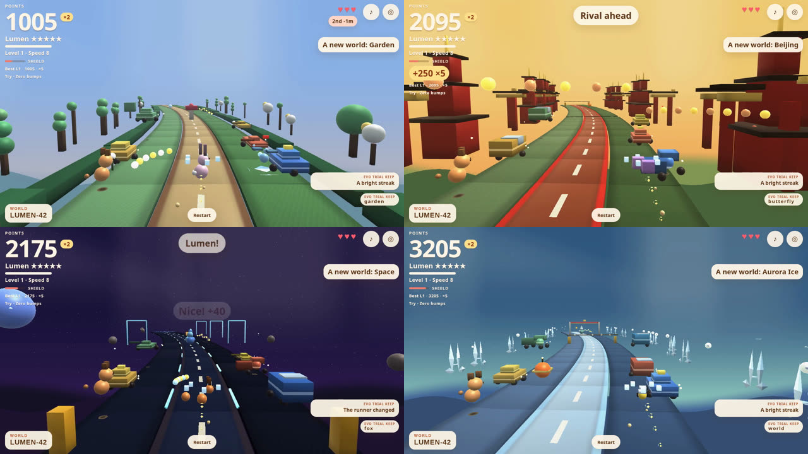

# Lumen Run

A kid-friendly 3D runner whose worlds, runner, and phrases are evolved live by [Aura](https://github.com/cybrid-systems/aura).

[](docs/media/lumen-run-demo.mp4)

Hero on autopilot, voice switches worlds, each new world is an Aura Biome EDSL form gated by `evo:trial` KEEP/ROLLBACK, rebound live with no restart.

## Quick start

Linux x86_64 or arm64, Node.js 22, `bash`, `curl`, and `python3`. The first `./run.sh` downloads the Aura nightly into `.tools`.

```bash
./run.sh
```

Open the URL it prints. Ctrl-C stops the core and the page. If 8080 or 8765 is taken, `./run.sh` prints the next free port. `AURA_RUNNER_WEB` and `AURA_RUNNER_PORT` pin one. Set `AURA_BIN` to skip the download: `AURA_BIN="$(command -v aura)" ./run.sh`.

## Controls

| Key | Action |
| --- | --- |
| W / ↑, or a tap | Jump |
| A / ← | Lane toward screen-left |
| S / ↓ | Slide |
| D / → | Lane right |
| Hold Space, then release | Speak |
| R, or Restart | Start this run over |
| Space or Enter | Start over after the run settles (0 hearts) |

A gamepad uses A to jump, B or down to slide, and the d-pad or stick for lanes. A left swipe matches A.

## Voice

Hold Space, speak, and release. Built-in lines apply at once and the combo stays. A custom world uses its themed recipe immediately when no LLM key is set.

| Say | What changes |
| --- | --- |
| 花园 / garden, 城市 / city, 太空 / space, 海边 / coast | Venue |
| 夜晚 / night, 白天 / day, 日落 / sunset, 霓虹 / neon | Mood |
| 去北京 / paris, 下一个城市 / next city | World tour |
| 去火山 / volcano, 糖果 / candy, 珊瑚 / coral | New world |

## Evolution

A world, the runner, or a phrase is proposed while the run stays up. `evo:trial` returns KEEP or ROLLBACK. Only KEEP rebinds, live, with no restart. With no LLM key, a themed recipe takes that same gate, and later levels recombine the kept pool offline.

The form in [`lib/edsl.aura`](lib/edsl.aura):

```
(biome ID
  (label WORD)
  (sky ZR ZG ZB HR HG HB)
  (fog FR FG FB AMT)
  (body sun|moon|stars|aurora|none)
  (road R G B) (curb R G B) (ground R G B)
  (surface grass|stone|dust|sand|ice|cloud|lava|reef|plank)
  (light L) (mood M)
  (particles fireflies|stardust|snow|embers|rain|sparkles|none DENSITY)
  (props (KIND DENSITY SCALE) ...)
  (recipe garden|city|space|coast|mix))
```

KIND is tree, tower, arch, crystal, rock, coral, or ring.
A proposal is kept only after evo:trial (edsl-gate).

## LLM

With no key, the offline generator still builds the run. These are the `LLM_*` variables the repo reads.

| Variable | Role |
| --- | --- |
| `LLM_API_KEY` | API key. When it is already set, `./run.sh` leaves it in place |
| `LLM_BASE_URL` | OpenAI-compatible base URL |
| `LLM_MODEL` | Model id |
| `LLM_TIMEOUT` | HTTP timeout in seconds (default 120). When unset, the core reads `AURA_HTTP_TIMEOUT` |

Wished-object calls with no provider selected fill an empty `LLM_BASE_URL` with `https://api.deepseek.com/v1` and an empty `LLM_MODEL` with `deepseek-chat`.

With no `LLM_API_KEY`, `./run.sh` fills those three from `~/code/keys/deepseek` (`DEEPSEEK_KEY_FILE`) or `~/code/keys/minimax` (`MINIMAX_KEY_FILE`). `./run.sh minimax` prefers MiniMax when that key is usable. The key-file defaults are DeepSeek `deepseek-flash` and MiniMax `MiniMax-M3.1-Flash`.

## Picture

Auto starts on Low and moves to Medium or High only after frames stay under budget, then steps back if they miss. Low is the original single pass, with the round contact shadows. Medium and High add a sun shadow, bloom, ACES tonemapping, a scene colour grade, and FXAA. High also adds a short speed blur, light shafts, a small ambient occlusion pass, and a brighter hero trail. On those tiers the camera eases a lane change, kicks the field of view with speed, and shakes on a near miss. A kept scene or hero pulses the bloom. A rollback cools the frame. The score stays in the page, so it stays sharp. A browser without WebGL2 draws a flat garden and says so.

The budgets live in [`lib/quality.aura`](lib/quality.aura). The page carries the same numbers, because it does not ask Aura to run them. Quality is not an `evo:trial`. A world, the runner, and a phrase still are. Pick Auto, Low, Medium, or High from the corner control. The browser remembers the choice.

## Layout

```
core/      Aura entry (core/main.aura): simulation, wishes, evo:trial
web/       WebGL2 view. Low is one pass; Medium and High add shadow, bloom, grade, and FXAA
lib/       Biome EDSL, physics, voice, pals, hearts, race
scripts/   Checks, seeded play-review, LLM probe
bridge/    Static page and the WebSocket bridge. ./run.sh starts it
docs/      Demo poster and video
```

## Checks

Aura commands need `AURA_SANDBOX=off` and a nightly binary on `PATH`. CI runs that job on `ghcr.io/cybrid-systems/aura:nightly` ([`.github/workflows/ci.yml`](.github/workflows/ci.yml)).

| Command | Checks |
| --- | --- |
| `aura test` | Core tests |
| `aura --quiet --preset dev scripts/play-review.aura` | Seeded stretch notes |
| `node scripts/check-sim.mjs` | Physics golden |
| `node scripts/check-lanes.mjs` | Screen-left lanes |
| `node scripts/check-contrast.mjs` | Obstacle contrast |
| `node scripts/check-quality.mjs` | Quality tiers, fallbacks, sim step |
| `node scripts/check-edsl.mjs` | Biome EDSL view |
| `node scripts/check-run.mjs` | Multiplier, venues, voice |
| `node scripts/check-probe.mjs` | Startup model probe |
| `bash scripts/check-install.sh` | Install from an empty tools dir |
| `node scripts/smoke.mjs` | Seeded end-to-end run |
| `node scripts/mock-llm-e2e.mjs` | Mock LLM rebind |
| `node scripts/check-edsl-e2e.mjs` | EDSL gate and voice switch |
| `node scripts/check-setcode.mjs` | Rebind falls back to `set-code` |
| `node scripts/check-play.mjs` | Long run with a hung model call |
